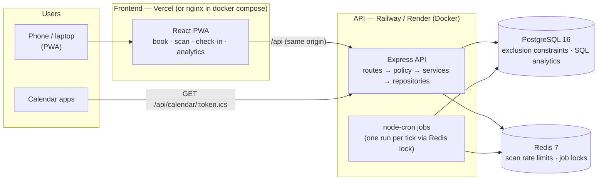

# LabDesk

[](https://github.com/vinithgomez/LabDesk/actions/workflows/ci.yml)

Lab & equipment booking and utilization system for a college department.

## The problem

Departments allocate labs, rooms and equipment over WhatsApp and a paper
register. That produces double bookings, no picture of how much anything is
really used, and no accountability when something breaks.

LabDesk replaces the register with:

- **Conflict-free booking, guaranteed by the database** — two bookings for the
  same resource can never overlap, however many requests race for a slot.
- **Approvals** — one or two levels (e.g. faculty, then the lab in-charge).
- **QR check-in and check-out**, recording *actual* use against *booked* use,
  with no-shows and forgotten check-outs handled automatically.
- **Waitlists and recurring bookings**, **maintenance windows** and
  **incident reports**.
- **Utilization analytics** that surface idle equipment and no-show patterns.
- **Calendar feeds** of each user's bookings, for any calendar app.

The full specification is `CLAUDE.md`.

## Architecture



- **The PWA** is a static React app (Vite). It talks to the API only through
  `/api` on its own origin: Vite's dev proxy locally, nginx in docker compose,
  a Vercel rewrite in production. So the refresh cookie is first-party.
- **The API** is stateless Express. Every request passes the single policy
  module (`auth/policy.ts`) before a service runs; services reach the database
  only through a unit of work, and every mutation is one transaction with its
  audit row. Access tokens live in memory; refresh tokens are rotating
  httpOnly cookies.
- **PostgreSQL enforces the invariants** that matter: no overlapping bookings
  (`EXCLUDE USING gist`), no overlapping maintenance windows, append-only
  audit and approval history. Analytics are SQL, not application code.
- **Redis** holds the QR-scan rate limit and the scheduled-job locks, so any
  number of API instances can run and each job still runs once per tick.
- **Scheduled jobs** run inside the API process (no separate worker): the
  no-show sweeper, auto-complete, lapsed-approval expiry, the waitlist
  promoter and expiry, and the nightly series materializer.

## Quick start: the whole app, seeded

Requires Docker.

1. `cp server/.env.example server/.env` (the placeholder values work locally)
2. `docker compose --env-file server/.env up --build`
3. Open http://localhost:8080 and sign in as `SEED_ADMIN_EMAIL` /
   `SEED_ADMIN_PASSWORD`, or as a demo user (e.g. `anita.rao@college.edu`,
   faculty; `arjun.nair@college.edu`, student) with `SEED_USER_PASSWORD`.

The API container applies migrations and seeds on start (both idempotent):
two departments, demo staff and students, eight resources and 8 weeks of
booking history for the analytics dashboard. Faculty, lab in-charges and
admins see `/analytics`; `/scan` is the QR scanner.

## Local development

1. `cp server/.env.example server/.env` — Postgres credentials live here
2. `docker compose --env-file server/.env up -d postgres redis` (Postgres on 5433, Redis on 6380)
3. `cd server && npm install`
4. `npm run db:migrate` — apply migrations
5. `npm run db:seed` — two departments (CSE, ECE), the bootstrap admin from
   `SEED_ADMIN_EMAIL` / `SEED_ADMIN_PASSWORD`, demo faculty / lab in-charges /
   students (password `SEED_USER_PASSWORD`) and resources in both departments,
   plus 8 weeks of demo booking history for the analytics dashboard (re-running
   the seed adds nothing it already added)
6. `npm run dev` — API on http://localhost:4000 (also runs the scheduled jobs)
7. `cd ../client && npm install && npm run dev` — the PWA on http://localhost:5173,
   proxying `/api` to the API. `/scan` is the in-app QR scanner; a printed
   code opens `/checkin?r=…&sig=…` directly from the phone's camera.

Print a resource's check-in code with `GET /api/resources/:id/qr` (owner or
admin). The code is static: it stays valid for the resource's lifetime, as long
as `PUBLIC_APP_URL` doesn't change.

## Tests

- **Server** — `cd server && npm test` (requires Docker). Unit tests, and
  integration tests against a real PostgreSQL 16 and Redis 7 started with
  Testcontainers, running the real migrations — never a mock or SQLite. This
  includes the 50-concurrent-bookings test below. Credentials come from
  `POSTGRES_*` in `server/.env`. To use existing services instead (CI does),
  set `TEST_DATABASE_URL` (the database name must end in `_test`: the tests
  truncate every table) and `TEST_REDIS_URL`.
- **Client** — `cd client && npm test`. Vitest and Testing Library in jsdom:
  the week calendar's grid maths (IST day boundaries, half-hour rows, drags
  made upwards, selections crossing IST midnight), the error-code sentences,
  and the booking panel's 409 recovery and Idempotency-Key reuse. They run in
  a New York time zone so any leak of the machine's local time fails.
- **End to end** — with the app running (either way above), `cd e2e && npm
  install && npx playwright install chromium && npm test`. One happy path on
  the real stack: register, sign in, book by dragging on the week calendar,
  owner approval, check-in through the resource's signed QR link, check-out.
  It skips itself in the last hour before IST midnight, when there may be no
  same-day slot left to book. Point it elsewhere with
  `E2E_BASE_URL` (e.g. `http://localhost:8080` for docker compose); set
  `E2E_BROWSER_CHANNEL=chrome` to use an installed Chrome.
- **Everything** — `npm test` at the repository root runs all three (the e2e
  part needs the app running).
- **Lint and typecheck** — `npm run lint` / `npm run typecheck` in `server/`
  and `client/`.

**CI** (`.github/workflows/ci.yml`) runs on every push and pull request to
`master`: server lint → typecheck → test → build (Postgres and Redis as
service containers), client lint → typecheck → test → build, then the Playwright flow
against a freshly migrated and seeded stack.

## Concurrency: what the exclusion constraint doesn't solve

**Goal.** Two bookings for the same resource must never overlap, and the
database enforces this rather than application logic. An application-level
check-then-insert is unsafe: under READ COMMITTED, two transactions can both
check, both see a free slot before either commits, and both insert.

**The constraint.** `bookings_no_overlap` is
`EXCLUDE USING gist (resource_id WITH =, period WITH &&) WHERE (status IN ('pending','approved','checked_in'))`,
where `period` is a half-open `tstzrange`. PostgreSQL enforces it at insert
time; a violation raises SQLSTATE 23P01, which the booking service maps to
`409 SLOT_CONFLICT`.

**The failure it exposed.** The constraint is correct but not sufficient under
burst load. With 50 simultaneous inserts for one slot, each insert blocks on
the other inserts' uncommitted rows. Inserters waiting on each other deadlock,
and PostgreSQL resolves a deadlock roughly once per second
(`deadlock_timeout`). The concurrency test went flaky, passing 3 of 5 runs,
with requests failing after about 45 seconds. In one captured failing run, 15
requests failed with deadlock errors (40P01), the other 35 exceeded the
15-second transaction timeout, and no booking succeeded.

**The fix.** `BookingWriter.insert` takes a per-resource, transaction-scoped
advisory lock, `pg_advisory_xact_lock(19524, hashtext(resource_id::text))`,
immediately before the INSERT. The lock orders inserts for one resource and
checks nothing. Each later inserter finds the winner already committed and
fails immediately with 23P01. Because the lock is transaction-scoped, `insert`
is only reachable through a transaction-bound client; calling it anywhere else
is a compile error. After the fix, the test passed 25 of 25 runs.

**The control.** The lock must not be what prevents double-booking. With the
constraint migration removed and the lock kept, the same test creates 50
bookings and fails.

**How the test gets real concurrency.** It sends 50 HTTP requests from 50
users through the real route, service and repository. Each request runs in
its own interactive transaction on a separate pooled connection and waits at
a barrier placed immediately before the INSERT. When the last one arrives,
and before any is released, a separate connection verifies that 50 distinct
backends are idle inside open transactions and that no booking has been
committed. The test then asserts exactly one `201`, 49 `409 SLOT_CONFLICT`
responses, and one stored row for the slot.

## Maintenance windows

`POST /api/maintenance` (resource owners and admins) records that a resource
is out of use. A window can always be created, whatever is booked: every
booking holding a slot it overlaps — pending, approved, or checked in — is
cancelled in the same transaction, audited as
`booking.cancelled_by_maintenance`, and the booking's own detail
(`GET /api/bookings/:id`) carries a `cancellation` explaining why, with the
window's times and reason. A session in progress is closed at the window's
start. Live windows for one resource never overlap (409
`MAINTENANCE_OVERLAP`); new bookings inside one get 409 `MAINTENANCE_BLOCKED`.
`DELETE /api/maintenance/:id` removes a window (a soft delete); bookings it
cancelled stay cancelled.

**Why a window can't slip past a booking in flight.** Creating a window takes
the resource row `FOR UPDATE`; inserting a booking holds it `FOR SHARE` from
its maintenance check through its INSERT. So a booking already past its check
finishes first and is then cancelled by the window, and a booking that
arrives while a window is being created waits, then sees the window and is
refused. Both orders are tested by pausing one side while it holds its lock.

## Incidents

`POST /api/incidents` reports damage or a fault (`minor`, `major`,
`out_of_service`), optionally tied to a booking. Anyone who has had a booking
on the resource (approved, checked in, completed or no-show) may report, as
may its owners and admins; only they may tie a report to someone else's
booking. `PATCH /api/incidents/:id/resolve` (owners and admins) closes it once,
with a note. `GET /api/incidents?resourceId=` lists a resource's incidents for
its managers; without `resourceId`, the ones you reported.

## Calendar feeds

`GET /api/calendar/feed` returns your personal subscription URL,
`…/api/calendar/<token>.ics`, which any calendar app can poll without signing
in. It lists your approved, checked-in and completed bookings from the last
90 days on; pending, cancelled, rejected, expired and no-show ones never
appear. The token is an HMAC of your user id and a feed version, keyed by
`ICS_TOKEN_SECRET`: unguessable, never stored, and the same every time you ask.
`POST /api/calendar/feed/regenerate` issues a new URL and revokes every earlier
one — use it if a link was shared by mistake.

## Analytics

`/analytics` in the PWA (faculty, lab in-charges and admins), backed by
`GET /api/analytics/{utilization,no-shows,heatmap,idle-ranking}`. Every figure
is computed in PostgreSQL. Each endpoint takes `from`/`to` (default: the last
4 weeks, clipped to now), `resourceId`, and `departmentId` (default: your own
department; only an admin may name another, or `all`).

- **Utilization** = in-hours checked-in minutes ÷ available minutes, so it
  never exceeds 100%. Available minutes come from each resource's own
  `business_hours_start`/`_end` on its `business_days` (IST; default
  08:00–18:00, Mon–Fri), counted from when the resource was created. Checked-in
  time outside those hours, or on any other day, is reported separately as
  `offHoursMinutes` and never enters the ratio; overlapping sessions are merged,
  so no minute counts twice. Booked minutes exclude cancelled and rejected
  (which includes expired) bookings. Everything is clipped to the window;
  sessions still open aren't counted, and auto-completed ones are, reported
  separately.
- **No-show rate** = no-shows ÷ (no-shows + completed + checked in). Rejected,
  expired, cancelled and undecided bookings are not attendance outcomes and
  never affect it.
- **Heatmap**: booked minutes per IST day-of-week × hour, all 168 cells
  present (zeros included); a booking counts in every hour it touches.
- **Idle ranking**: least used first. A resource needs 28 days observed in the
  window (from its creation, if later) to be ranked; inactive resources, those
  with less data, and those with no open hours are listed as excluded, with
  the reason.

## Scheduled jobs

`npm run dev` / `npm start` schedule these with node-cron (`JOBS_ENABLED=false`
turns them off). Every instance schedules them; a Redis lock
(`lock:<job-name>`) makes exactly one instance run each tick, and every job is
idempotent.

| Job | Schedule | Does |
|---|---|---|
| `no-show-sweeper` | every 5 min | approved, never checked in, past start + 15 min → `no_show` |
| `auto-complete` | every 15 min | checked in, never checked out, past end + 15 min → `completed` at the booked end |
| `expire-lapsed-pending` | every 5 min | still pending at its start → `rejected` |
| `waitlist-promoter` | every 5 min | books the oldest waiting entry whose period is now free |
| `waitlist-expiry` | every 5 min | waiting entries whose desired start has arrived → `expired` |
| `series-materializer` | 00:15 IST nightly | books each recurring series' occurrences out to the resource's booking horizon |

Waitlist promotions and series occurrences are inserted through the same path
as `POST /api/bookings`, so the exclusion constraint guards them too. A
promoted booking is `pending` or `approved` by the resource's
`requires_approval`, like any other. An occurrence that can't be booked
(e.g. `SLOT_CONFLICT`) is skipped, not retried, and listed with its reason
under `skipped` in `GET /api/series/:id`; the rest of the series is still booked.

## Deploying

The target from `CLAUDE.md` §3: the API on **Railway or Render** (from
`server/Dockerfile`), the PWA on **Vercel**, **managed PostgreSQL**, plus a
**managed Redis**. Nothing here has been provisioned; these are the steps.

### 1. Decide first (only you can)

- **Provider for the API, Postgres and Redis** — Railway (all three in one
  project) or Render (web service + Postgres + Key Value). Either works with
  the Dockerfile as is.
- **The app's final URL / custom domain.** `PUBLIC_APP_URL` is printed into
  every resource's QR code; changing it later invalidates every printed code.
  Pick the domain before printing anything.
- **Same-origin or cross-origin API.** Recommended: Vercel proxies `/api` to
  the API (step 4), so the browser sees one origin and the refresh cookie is
  first-party. The alternative — the PWA calling the API's own domain
  directly — relies on a cross-site cookie (`SameSite=None; Secure`), which
  some browsers restrict.
- **Demo data or not.** `SEED_ON_START=true` seeds demo users, resources and
  8 weeks of history. Right for a demo; wrong for real use.
- **Real secrets.** Generate fresh `JWT_ACCESS_SECRET`, `JWT_REFRESH_SECRET`
  and `ICS_TOKEN_SECRET` (e.g. `openssl rand -hex 32`) and a real admin
  password. Never reuse the `.env.example` placeholders.

### 2. PostgreSQL and Redis

Create a PostgreSQL 16 database and a Redis 7 instance with your provider.
The migrations enable `btree_gist`, `pgcrypto` and `citext`, which Railway,
Render, Neon and Supabase all allow. Note the connection URLs (a TLS Redis
URL starts with `rediss://`; that works as is).

### 3. The API (Railway or Render)

Create a service from this repository with root directory `server/`, built
from `server/Dockerfile`. On start the container runs `prisma migrate deploy`,
seeds if `SEED_ON_START=true`, then serves on `PORT`. Set the health check
path to `/api/health`. Several instances are fine: scheduled jobs take a
Redis lock, so each runs once per tick.

| Variable | Required | Value |
|---|---|---|
| `NODE_ENV` | yes | `production` |
| `PORT` | no | the platform sets it; default `4000` |
| `DATABASE_URL` | yes | from step 2 |
| `REDIS_URL` | yes | from step 2 |
| `JWT_ACCESS_SECRET`, `JWT_REFRESH_SECRET` | yes | fresh random values, 16+ characters |
| `ICS_TOKEN_SECRET` | recommended | fresh random value; if unset it's derived from `JWT_ACCESS_SECRET`, so rotating that would revoke every calendar URL |
| `PUBLIC_APP_URL` | yes | the PWA's final URL, e.g. `https://labdesk.example.edu` (printed into QR codes) |
| `PUBLIC_API_URL` | no | where calendar apps reach the API; defaults to `PUBLIC_APP_URL` (right when Vercel proxies `/api`) |
| `CORS_ORIGIN` | yes | the PWA's URL (only used if the browser calls the API cross-origin) |
| `COOKIE_SECURE`, `COOKIE_SAMESITE` | no | defaults in production: `true`, `none` — fine for both set-ups |
| `SEED_ON_START` | no | `true` to seed demo data on start (see step 1) |
| `SEED_ADMIN_EMAIL`, `SEED_ADMIN_PASSWORD` | when seeding | the bootstrap admin |
| `SEED_USER_PASSWORD` | when seeding | shared password for the demo accounts |
| `JOBS_ENABLED` | no | default `true` |
| `BCRYPT_ROUNDS`, `LOG_LEVEL`, `ACCESS_TOKEN_TTL`, `REFRESH_TOKEN_TTL` | no | defaults `12`, `info`, `15m`, `7d` |

### 4. The PWA (Vercel)

Import the repository with root directory `client/`, framework preset Vite
(build `npm run build`, output `dist`). Add `client/vercel.json` pointing
`/api` at your API, and every other path to the app (real files, such as
`/assets/*` and `sw.js`, are served before rewrites apply):

```json
{
  "rewrites": [
    { "source": "/api/:path*", "destination": "https://YOUR-API-HOST/api/:path*" },
    { "source": "/(.*)", "destination": "/index.html" }
  ]
}
```

Then attach your domain, and make sure `PUBLIC_APP_URL` (and `CORS_ORIGIN`)
on the API match it exactly.

### 5. Check

`https://YOUR-APP/api/health` returns `{"data":{"status":"ok"}}`; sign in as
the admin; print a resource's QR code from `GET /api/resources/:id/qr` and
scan it with a phone. The Playwright flow runs against any deployment:
`E2E_BASE_URL=https://YOUR-APP E2E_ADMIN_EMAIL=… E2E_ADMIN_PASSWORD=… E2E_USER_PASSWORD=… npm test`
in `e2e/` (it creates an "E2E Lab" resource and a throwaway student account,
so run it against a demo deployment, not a real one).

## Future work

- **Multi-day equipment loans.** Bookings are same-day by design (§2b);
  lending equipment for days at a time needs its own model.
- **Frontend screens** for the approvals inbox and admin (resources,
  maintenance, incidents). The API for both exists; the PWA has sign-in and
  registration, the resource directory, the week calendar, my bookings (with
  the calendar-feed link), scanning, check-in and analytics.
- **Notifications** (email/push) — promotions, approvals and maintenance
  cancellations are visible only in the app today.

## Backend layout (`server/src`)

```
routes/        HTTP: Zod request/response schemas, calls can(), then services
services/      use cases; no req/res, no Prisma — only the UnitOfWork
repositories/  the only code that touches Prisma
auth/policy.ts the single authorization module: can(actor, action, subject)
http/          envelope, error mapping, bearer-token middleware
```
